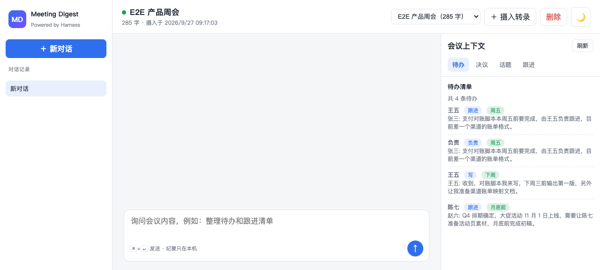
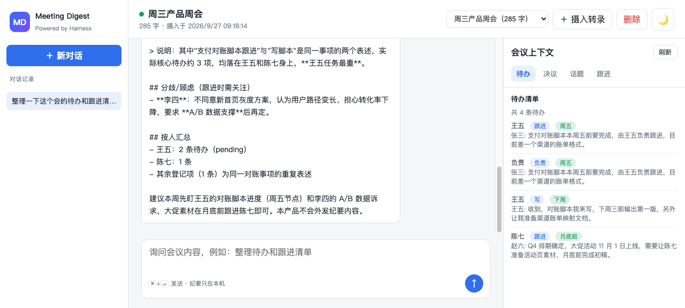
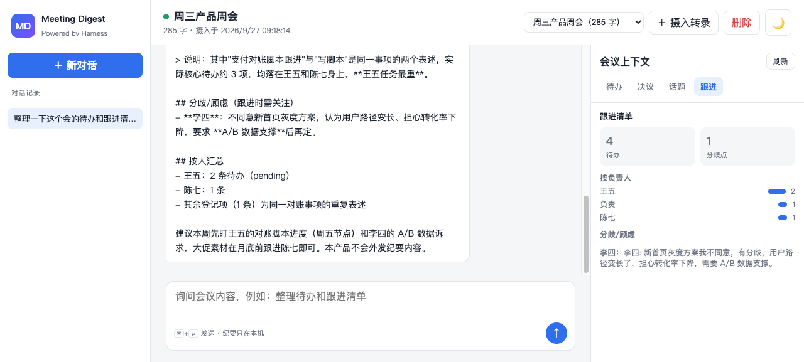

# DSH Meeting Digest（会议纪要蒸馏器）

独立的 AI 原生产品（非"业务系统 + 右侧 AI 助手"形态）：粘贴会议转录文本，即刻蒸馏出**待办、决议、分歧、话题切分、跟进清单**，并可自然语言追问会议内容。基于本地规则提取，不臆造转录中未提及的内容，纪要数据不出本机。

> 深度集成为 DSH（deepseek-harness-java）Java Native Plugin 生态的独立 AI 产品案例之一，对标 dsh-java-mysql（MySQL Studio）形态。



## 功能

- **转录摄入**：粘贴/保存会议转录文本（支持 `说话人: 内容` 与 `[00:12] 说话人: 内容` 两种格式），本地持久化到 `~/.dsh-java-meeting/meetings.json`
- **待办提取**：识别「谁 + 做什么 + 何时」，含负责人、截止时间、上下文
- **决议提取**：抽取「决定 / 敲定 / 确定…上线」等决议表述
- **话题切分**：按发言切换自动分段，给出每段主导发言人与预览
- **跟进清单**：待办 + 分歧点 + 按负责人聚合，一眼看清谁欠什么
- **AI 追问**：SSE 流式对话，AI 强制调用会议工具查证后回答，禁止编造

## 工具（DSH Java Native Plugin）

插件 ID：`dsh-java-meeting-plugin`，工具前缀 `mtg_`：

| 工具 | 说明 |
|------|------|
| `mtg_ingest_text` | 摄入转录文本（title + text） |
| `mtg_extract_actions` | 待办提取（谁/做什么/何时） |
| `mtg_extract_decisions` | 决议清单 |
| `mtg_split_topics` | 话题切分 |
| `mtg_followup_list` | 跟进清单（待办 + 分歧 + 按人聚合） |

## 快速开始

```bash
# 构建
mvn package -DskipTests

# 启动 app（端口 8104）
SERVER__PORT= java -jar dsh-java-meeting-app/target/dsh-java-meeting-app-0.1.0-SNAPSHOT.jar --server.port=8104

# 安装并激活插件到 harness（harness 默认 127.0.0.1:8090）
cp dsh-java-meeting-plugin/target/dsh-java-meeting-plugin-0.1.0-SNAPSHOT.jar ~/.dsh/standalone/plugins/dsh-java-meeting-plugin.jar
curl --noproxy '*' -X POST http://127.0.0.1:8090/api/harness/plugins/install -H 'Content-Type: application/json' -d '{"jarName":"dsh-java-meeting-plugin.jar"}'
curl --noproxy '*' -X POST http://127.0.0.1:8090/api/harness/plugins/activate -H 'Content-Type: application/json' -d '{"pluginId":"dsh-java-meeting-plugin"}'
```

打开 <http://127.0.0.1:8104>，「＋ 摄入转录」粘贴文本即可开始。

## E2E 测试

前置：app 已启动（8104）、harness 已启动（8090）、插件已安装激活。

```bash
python3 meeting_digest_e2e.py
# 7/7 PASS：摄入 / 待办 / 决议 / 跟进 / 话题 / AI 工具调用 / 短文本拒绝
```

## 截图

| 场景 | 图 |
|------|-----|
| 首页 + 待办面板 |  |
| AI 追问（工具调用 + 按人汇总） |  |
| 跟进清单（按负责人聚合 + 分歧点） |  |

## 安全边界

- 纯只读设计：除摄入/删除自身会议数据外无任何外部写操作，不外发纪要内容
- 提取全部基于本地规则，AI 回答强制先调用工具查证，禁止臆造
- 数据仅存本机 `~/.dsh-java-meeting/`

## 技术

Java 17 · Spring Boot 3.3 · DSH Java Native Plugin（`AbstractHarnessPlugin`）· SSE 流式 · 端口 8104
